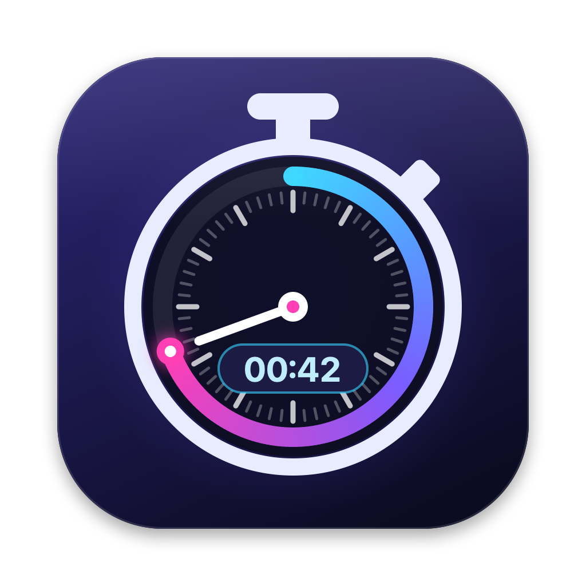

# Kronometre

A tiny, native **menu bar stopwatch** for macOS. The elapsed time lives in your
menu bar — one click to start or pause, right-click for the rest. No window, no
Dock icon, no dependencies.

> *Kronometre* is Turkish for "stopwatch".



---

## Features

- **Lives in the menu bar** — `.accessory` activation policy, so there's no Dock
  icon and no app-switcher clutter.
- **Left-click to start / pause**, right-click for the menu (Reset, Launch at
  login, Quit).
- **Sleep- and restart-proof.** Elapsed time is computed from the *start instant*
  (`Date`), not by incrementing a counter — so sleeping the Mac, quitting, or
  relaunching never drifts the time.
- **Launch at login** via `SMAppService` (the modern, sandbox-friendly API — no
  legacy login-item hacks).
- **Monospaced digits** so the width doesn't jitter as the seconds tick.
- **Zero dependencies.** Pure AppKit + `ServiceManagement`. The binary is a few
  hundred KB.

## Install

Requires macOS 14+ and Apple's Command Line Tools (`xcode-select --install`) —
**no full Xcode needed.**

```bash
git clone https://github.com/lionysf7-debug/kronometre.git && cd kronometre
./build.sh --install        # builds, ad-hoc signs, installs to /Applications, launches
```

Or just build it without installing:

```bash
./build.sh                  # produces build/Kronometre.app
```

## Usage

| Action        | Result                                   |
| ------------- | ---------------------------------------- |
| Left-click    | Start / pause                            |
| Right-click   | Menu: Start/Pause · Reset · Launch at login · Quit |

The icon reflects the state: `stopwatch` when idle, `stopwatch.fill` while
running, `pause.circle` when paused with time on the clock.

## How it works

The design keeps the clock honest across sleep and restarts by never counting
ticks — it stores a `startDate` and an `accumulated` interval, and derives the
displayed time on demand:

```swift
var elapsed: TimeInterval {
    accumulated + (startDate.map { Date().timeIntervalSince($0) } ?? 0)
}
```

Both values are persisted to `UserDefaults` on every change, so the stopwatch
survives a quit or a reboot. A `0.2 s` timer (with tolerance, added in
`.common` run-loop mode so it keeps ticking while the menu is open) only
*refreshes the label*; it never owns the time. The label is diffed against the
last rendered value, so the status item is only redrawn when the displayed
string actually changes.

## Built with

`Swift` · `AppKit` (`NSStatusItem`) · `ServiceManagement` (`SMAppService`) ·
`UserDefaults` · SF Symbols · `swiftc` (Xcode-free build + ad-hoc codesign).

## License

MIT — see [LICENSE](LICENSE).
